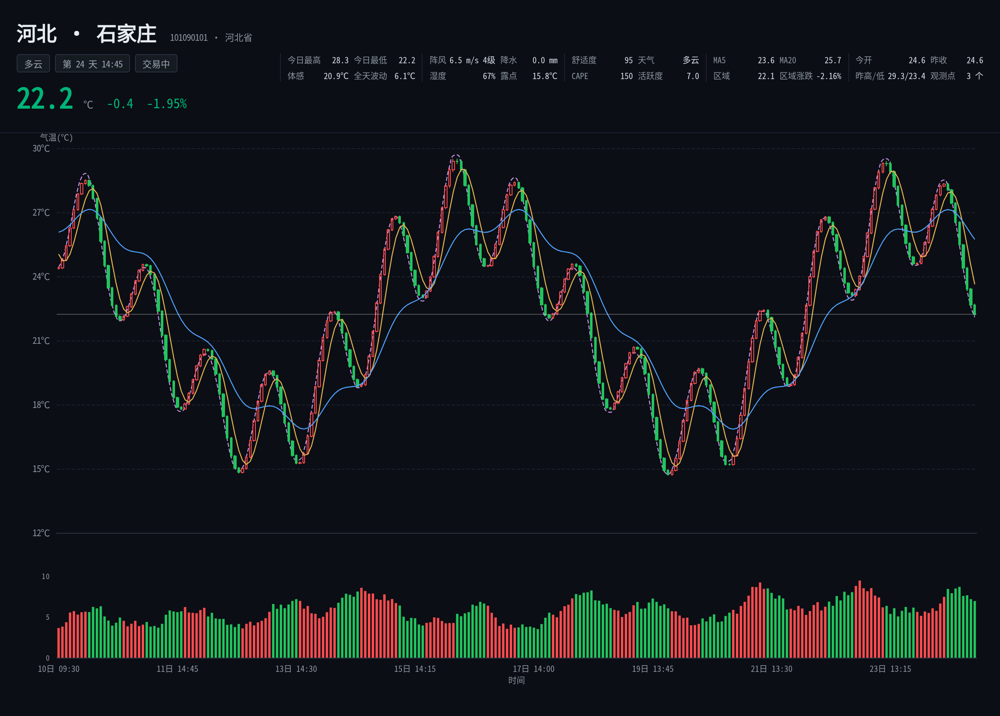

  
   
  

# nonebot-plugin-weather-fighter

## 📖 介绍

本项目基于[weather-fighter](https://github.com/lolikonnn/weather-fighter)二次开发   
可以先给原项目一个star哦(●′ω`●)

## 💿 安装(以下选择其一安装即可)

使用 nb-cli 安装 (十分甚至九分的推荐)

在 nonebot2 项目的根目录下打开命令行, 输入以下指令即可安装
  
    nb plugin install nonebot-plugin-weather-fighter

使用 pip 安装

在 nonebot2 项目的根目录下打开命令行, 输入以下指令即可安装
  
    pip install nonebot-plugin-weather-fighter

如果安装完插件不载入的话,在nonebot文件夹中找到**pyproject.toml**,在**plugins**里面添加**nonebot-plugin-beatsaberscore**就完成了

>如果你的Nonebot2项目下已经启用虚拟环境,可以使用Pipenv安装到项目中,但你需要安装pipenv包
>

使用 pipenv 安装

先安装pipenv
  
    pip install pipenv
  
在 nonebot2 项目的根目录下打开命令行, 输入以下指令即可安装
  
    pipenv install nonebot-plugin-weather-fighter

使用 uv 安装

    uv sync
    uv add nonebot-plugin-weather-fighter

## 🔄 更新
> [!NOTE]
> ***请不要用上面的安装方式更新!!!!!!!!!!!!***

使用 nb-cli 更新

在 nonebot2 项目的根目录下打开命令行, 输入以下指令更新
  
    nb plugin install nonebot-plugin-weather-fighter --upgrade

使用 pip 更新

在 nonebot2 项目的根目录下打开命令行, 输入以下指令即可更新
  
    pip install nonebot-plugin-weather-fighter --upgrade

## 🎉 命令

| 命令 | 说明 |
|---|---|
| `天气 [省份/城市]` | 主图截图 + 现在天气 + 今日高低温 + 未来 1 小时；`行情` / `大盘` / `K线` 是同一命令的别名；不用开盘 |
| `买入 [省份] [金额] [倍数 N]` | 做多；金额不填默认 20%；可选 `倍数 5` / `杠杆 5` |
| `卖出 [省份] [金额] [倍数 N]` | 写金额做空；不写金额默认平仓；可选 `倍数 5` / `杠杆 5` |
| `到价 [省份] 价格 买入|卖出 [金额]` | 价格触及自动买入/卖出 |
| `到价 [省份] 价格 平` | 价格触及自动平掉该省 |
| `平仓 [省份]` | 平掉(全部卖掉)该省；不带省平掉全部持仓（只平仓，不主动结算） |
| `撤单` | 取消自己的到价单 |
| `倍数 [N]` | 设置杠杆倍数（1~上限，有持仓时不能改）；不带参数查看当前倍数 |
| `帮助 [省份]` | 命令说明 / 省份详情 |

## 📝 PS

- **所有群共用一个盘**：所有群共用一条行情时间轴
- 每个玩家的余额、持仓、到价单互相独立；**可以同时在多个省持仓**，每个省最多一个持仓；账户按群隔离。
- 全时段连续交易：每天 96 根 15 分钟 K 线（24×7），没有午休、周末和节假日休市。
- **完全按真实时间连续运行，没有盘到期**；发命令时懒补齐到当前真实时间。
- 简化规则：投入多少最多亏多少；不显示手续费/滑点/保证金/强平价/手数；倍数默认 1 倍，可在下单时带 `杠杆 5`，或先用 `倍数 5` 设置；上限由 `WEATHER_FIGHTER_LEVERAGE` 决定。
- 地区当前只开放全国 34 个省级行政区的天气；352 城数据保留在 `regions.json`，后续开放。
- 法定节假日：使用 `chinesecalendar`（随依赖更新）
- 彩云 v2.6 客户端预留,如果没配置彩云天气的API(`WEATHER_FIGHTER_CAIYUN_TOKEN`)默认使用免费的`Open-Meteo`数据
- 缓存：懒刷新 + 30 分钟桶 + 单飞 + 负缓存 + 旧值兜底,尽可能减少请求次数
- 保底机制: 没钱可以等着吃`保底`,低于默认余额（`WEATHER_FIGHTER_PRINCIPAL`）的 `20%`（2,000）时进入保底；每个真实自然日补默认余额的 `5%`（500），补到 `35%`（3,500）停止。
- **中文字体**已随插件打包，**不需要**系统安装 CJK 字体。
- 如果你有更好的想法和建议,随时欢迎提出[issues](https://github.com/qwq12738qwq/nonebot-plugin-weather-fighter/issues/new)~(●´∀｀●)

## 配置

| 环境变量 | 默认值 | 说明 |
|---|---:|---|
| `WEATHER_FIGHTER_BUCKET_BARS` | 1800 | 15 分钟行情桶（秒） |
| `WEATHER_FIGHTER_STALE_SECONDS` | 21600 | 旧值最多可用时长 |
| `WEATHER_FIGHTER_HTTP_TIMEOUT` | 30 | 单次 HTTP 超时（秒） |
| `WEATHER_FIGHTER_PRINCIPAL` | 10000 | 每个玩家在每个群的初始余额 |
| `WEATHER_FIGHTER_LEVERAGE` | 100 | 杠杆上限（玩家可在 1~该值之间自选） |
| `WEATHER_FIGHTER_SAFETY_ENTRY_PCT` | 20 | 低于默认余额的百分比时进入保底 |
| `WEATHER_FIGHTER_SAFETY_GRANT_PCT` | 5 | 每个真实自然日补默认余额的百分比 |
| `WEATHER_FIGHTER_SAFETY_TARGET_PCT` | 35 | 补到默认余额的百分比后停止触发 |
| `WEATHER_FIGHTER_CHART_BARS` | 96 | 主图节点数（96 根 = 1 天，其中约 15% 为预测尾段） |
| `WEATHER_FIGHTER_ENABLE_REGION` | true | 是否加载同省区域指数 |
| `WEATHER_FIGHTER_CAIYUN_TOKEN` | 空 | 彩云 token（预留） |

## 主图

> 这只是一个示例~~~。
